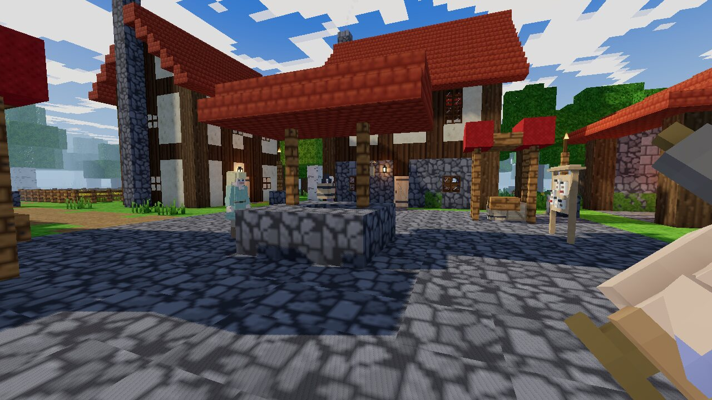
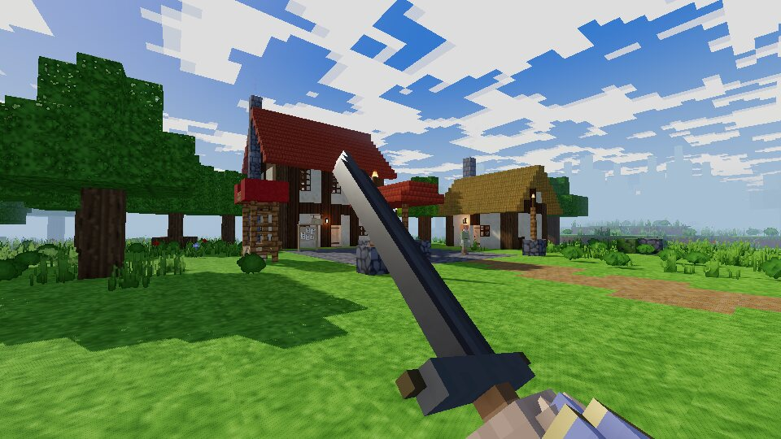
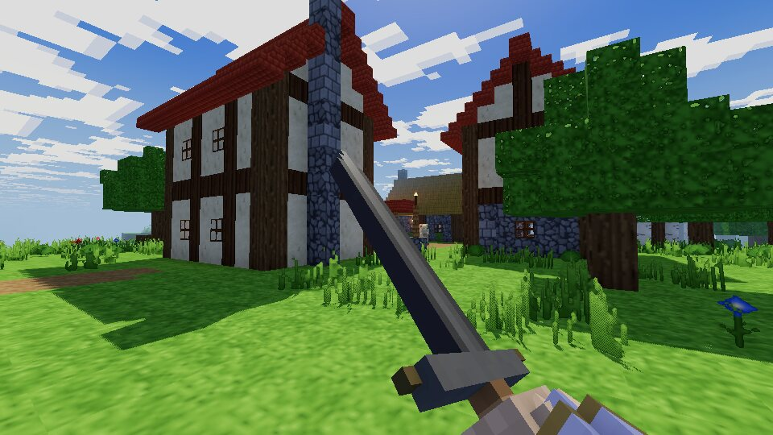
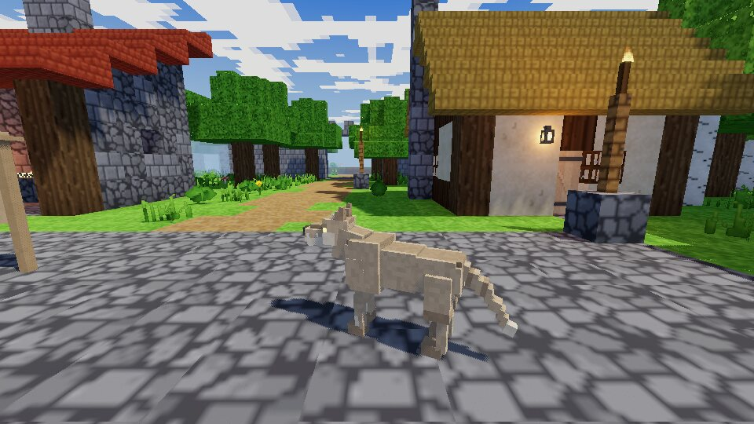
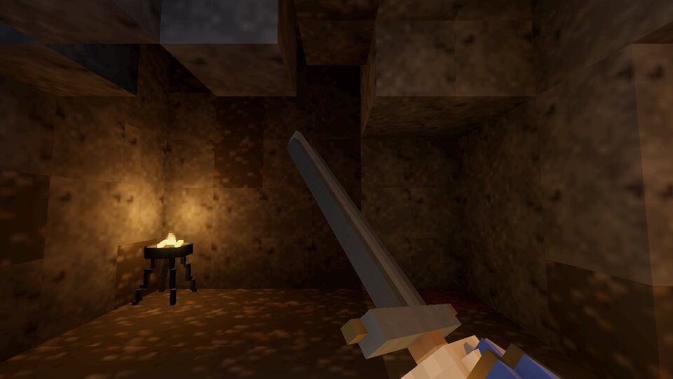
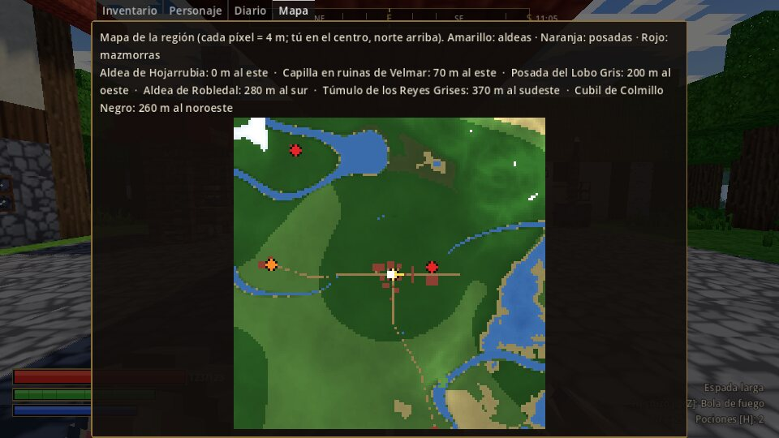

# Vaelmoor — Crónicas de la Marca

RPG de fantasía medieval en **primera persona** con estética **voxel**, inspirado en la libertad de
los RPG clásicos de mundo abierto (exploración, ciudades, mazmorras, generación procedural).
Hecho con **Godot 4.7** (GDScript tipado, renderizador *Compatibility*) y pensado **exclusivamente
para Linux x86_64**. Un solo jugador, sin conexión.

Todo el arte es **original y generado por código**: texturas pixel-art, modelos de micro-vóxeles,
animaciones esqueléticas, cielo y efectos de sonido sintetizados. No se usa ningún recurso de
terceros (ver [ATTRIBUTIONS.md](ATTRIBUTIONS.md)).



| | | |
|---|---|---|
|  |  |  |
| Posada del Lobo Gris | Aldea de Robledal | Lobo (rig cuadrúpedo animado) |
|  |  | |
| Cueva de los lobos | Mapa regional con lugares | |

*Capturas tomadas automáticamente con el binario de pruebas (Vulkan por software, sin GPU); el
juego usa el renderizador Compatibility (OpenGL 3.3), así que los colores pueden variar un poco.*

---

## Estado del desarrollo

| Fase | Contenido | Estado |
|---|---|---|
| 1 | Prototipo jugable: aldea voxel, jugador en 1.ª persona con brazos y espada, enemigo animado, combate real, HUD, menú, sonido | **Completada** |
| 2 | Calidad visual y animaciones: armas con animaciones propias, arco y magia, brazos con IK, esqueletos, bandidos y lobos con máquina de estados | **Mayormente hecha** |
| 3 | Región procedural, mazmorra conectada, carga por chunks, semilla persistente | **Hecha** |
| 4 | Sistemas RPG y guardado: atributos, habilidades por uso, inventario con peso, **equipo por ranuras con armadura y resistencias**, **cerraduras y ganzúas**, comercio, guardado seguro | **Hecha** |
| 5 | PNJ con horarios y diálogos, misiones con etapas (incluida una de **búsqueda de una persona desaparecida**), banderas de historia, facciones y reputación | **Hecha** |
| 6 | Expansión: posada de camino, aldea de Robledal, túmulo, cubil de lobos y **campamento de bandidos** procedurales, caminos, fauna con manadas, mazmorras temáticas | **Hecha (región ampliada)** |
| 7 | Pulido y distribución Linux: exportación reproducible, paquete .tar.xz, instalador de usuario | **Parcial** (sin AppImage ni pruebas en GPU real) |

Consulta [docs/FASES.md](docs/FASES.md) para el detalle de lo implementado, las pruebas y lo que falta.

## Qué se puede hacer ahora mismo

- Crear un personaje (nombre, clase: Guerrero, Explorador o Mago de batalla) y una semilla de mundo.
- Explorar un mundo voxel **procedural y reproducible** (relieve, ríos, bosques templados, llanuras,
  taiga, desierto, pantano…) que se carga por **chunks** alrededor del jugador.
- Recorrer la **aldea de Hojarrubia**: posada de dos plantas con barra, casas con entramado de madera,
  tejados de teja y paja, chimeneas humeantes, herrería con fragua y yunque, torre de vigilancia con
  escalera de caracol y almenas, muralla con puerta, pozo, puestos de mercado, huerto, farolas.
- Abrir y cerrar **puertas**, abrir **cofres** con botín, tomar armas del **armero** de la herrería.
- **Forzar cerraduras** de cofres y jaulas con **ganzúas** (la probabilidad depende de la habilidad
  *Ganzúas*, la agilidad y la suerte frente a la dificultad; al fallar la ganzúa puede romperse) o
  abrirlas con su llave. Algunos cofres de las mazmorras están cerrados.
- Visitar la **capilla en ruinas de Velmar** y el **cementerio olvidado**, custodiados por
  **guerreros esqueleto**.
- Combatir con **espada larga, hacha, maza o daga** (cada una con animaciones propias), bloquear,
  hacer **paradas perfectas**, esquivar, atacar con sigilo; los enemigos detectan, persiguen,
  bloquean con escudo, reaccionan a los golpes, quedan aturdidos y mueren.
- Usar **arco** (flechas físicas) y **magia** (bola de fuego, escarcha, curación) con estados alterados.
- **Equiparte** por ranuras (cabeza, torso, manos, piernas, pies y escudo): ropa, cuero, malla y hierro
  con valor de armadura que mejora con la habilidad, resistencias mágicas y aspecto visible en los
  brazos; la armadura reduce el daño físico y las resistencias el mágico.
- Hablar con los **PNJ** (horarios de trabajo y descanso, rumores, comercio) y completar **misiones**
  que cambian la reputación con las facciones.
- Leer los **tablones de anuncios** de cada asentamiento: encargos generados (caza, limpieza de no
  muertos, entregas) que cambian cada pocos días y se cobran en el propio tablón.
- Viajar por la región: la **Posada del Lobo Gris** al oeste, la **aldea de Robledal** al sur, el
  **Túmulo de los Reyes Grises** y el **Cubil de Colmillo Negro** (posiciones según la semilla; el
  mapa, tecla M, indica dirección y distancia), unidos por caminos.
- Enfrentarte a **manadas de lobos** que acechan, se avisan entre sí, saltan a morder y huyen
  heridos; los animales salvajes reaparecen pasados unos días.
- Buscar a **Lina**, la hija desaparecida del granjero Bram: preguntar en la posada, encontrar el
  **campamento de los Cuervos** (empalizada, tiendas de lona, torre de vigía con arquera, hoguera) que
  aparece en el mapa cuando alguien te habla de él, vencer a los **bandidos** (salteadores, matón,
  arquera y su jefe Garra) o colarte por la brecha de la empalizada, y abrir la **jaula** con la llave
  del jefe o con ganzúas. Lina vuelve a casa por su propio pie y desde entonces vive en Robledal.
- Explorar **mazmorras temáticas** (cripta, túmulo, cueva) con llaves, palancas, salas secretas,
  trampas y jefes.
- Ciclo de **día y noche** con cielo, nubes voxel, estrellas, luz de antorchas, faroles y aullidos
  lejanos por la noche.
- **Guardar y cargar** (también guardado rápido F5 / carga rápida F9).

## Requisitos

- Linux **x86_64** con **glibc 2.35 o superior** (Ubuntu 22.04+, Linux Mint 21+, Debian 12+, Arch).
- Gráfica con **OpenGL 3.3** (drivers Mesa recientes para Intel/AMD, o NVIDIA propietario).
- Sesión **X11** o **Wayland con XWayland** (lo habitual en GNOME/KDE).
- Audio: PulseAudio, PipeWire (con su capa de PulseAudio) o ALSA.
- Opcional: mando compatible (soporte vía SDL3).

## Instalación (paquete binario)

El paquete ya compilado y probado está en la carpeta [`release/`](release/) del repositorio
(`vaelmoor-0.1.0-linux-x86_64.tar.xz`, ~19 MB, con su suma SHA-256). También puedes generarlo tú
mismo (ver «Exportar y empaquetar»).

0. (Opcional) Comprueba la descarga: `sha256sum -c vaelmoor-0.1.0-linux-x86_64.tar.xz.sha256`
1. Descomprime el paquete: `tar xf vaelmoor-0.1.0-linux-x86_64.tar.xz`
2. Ejecuta: `cd vaelmoor-0.1.0-linux-x86_64 && ./vaelmoor.sh`
3. (Opcional) Instálalo para tu usuario, con entrada en el menú de aplicaciones:
   `./install.sh` (desinstalar: `./install.sh --uninstall`).

El paquete se genera con los scripts de exportación descritos abajo (no hay instalador para otros
sistemas operativos).

## Ejecutar desde el código fuente

1. Instala el editor de **Godot 4.7.x** para Linux (<https://godotengine.org/download/linux/>), o
   compílalo con `tools/build_godot_from_source.sh`.
2. En la carpeta del proyecto: `GODOT=/ruta/a/godot ./run.sh`
   (si `godot`/`godot4` está en el `PATH`, basta `./run.sh`). La primera vez importa los recursos.
3. También puedes abrir `project.godot` con el editor y pulsar *Ejecutar*.

## Exportar y empaquetar (reproducible)

```bash
# 1) Exportar (necesita el editor 4.7.x y la plantilla release de Linux)
GODOT=/ruta/al/editor GODOT_TEMPLATE=/ruta/a/linux_release.x86_64 scripts/export_linux.sh
#    (sin GODOT_TEMPLATE se usan las plantillas instaladas en ~/.local/share/godot/export_templates/4.7.2.stable/)
# 2) Paquete .tar.xz con lanzador, instalador, README y licencias -> dist/
scripts/package_linux.sh
# 3) (Opcional) AppImage, si tienes appimagetool instalado
scripts/make_appimage.sh
```

Para verificar una exportación en cualquier distribución:

```bash
./vaelmoor.x86_64 --headless -- --self-test
```

Ejecuta una partida automática (cargar el mundo, caminar, saltar, combatir contra un esqueleto,
saquear, guardar y cargar) e imprime un informe; devuelve 0 si todo funciona.

## Controles

| Acción | Teclado / ratón | Mando |
|---|---|---|
| Moverse | W A S D | Stick izquierdo |
| Mirar | Ratón | Stick derecho |
| Saltar | Espacio | A |
| Correr (consume aguante) | Mayús | Pulsar stick izquierdo |
| Agacharse (sigilo) | Ctrl o C | B |
| Esquivar | Alt o V | Pulsar stick derecho |
| Atacar | Clic izquierdo | Gatillo derecho |
| Bloquear | Clic derecho | Gatillo izquierdo |
| Interactuar / abrir / saquear | E | X |
| Poción de salud | H | Cruceta arriba |
| Cambiar de arma | 1-5 o rueda del ratón | RB |
| Pausa / menú | Esc | Start |
| Guardado rápido / carga rápida | F5 / F9 | — |
| Información de depuración (FPS, posición, bioma) | F3 | — |
| Captura de pantalla | F12 | — |

**La dirección del ataque depende del movimiento**: quieto se encadenan tajos y golpes verticales;
avanzando se lanza una estocada; moviéndose a izquierda o derecha, tajos en esa dirección.
Bloquear justo antes de recibir el golpe produce una **parada perfecta** que aturde al enemigo.
Un ataque agachado contra un enemigo que no te ha visto es un **ataque furtivo** (daño ×2,5).
Ante un cofre o una jaula cerrados, **E** usa la llave si la llevas; si no, intenta **forzar la
cerradura** con una ganzúa (el aviso en pantalla muestra la dificultad, la probabilidad y cuántas
ganzúas te quedan).

## Opciones

Menú *Opciones* (principal o pausa): pantalla completa, V-Sync, campo de visión, **distancia de
dibujado** (3-12 chunks), calidad de **sombras**, MSAA, **escala de resolución 3D**, balanceo de
cámara, volumen general/efectos/ambiente, sensibilidad del ratón, invertir eje Y, mostrar FPS.
Se guardan en `~/.local/share/vaelmoor/settings.cfg`.

## Partidas guardadas

- Carpeta: `~/.local/share/vaelmoor/saves/` (JSON legible y versionado).
- Se guarda posición, atributos, habilidades, salud/aguante/magia, armas, oro, inventario, semilla
  del mundo, hora y día, y los cambios del mundo (enemigos muertos, cofres saqueados, puertas).
- Escritura **atómica**: se escribe un temporal, se verifica y solo entonces reemplaza al anterior,
  que se conserva como `.bak`. Si una partida está dañada, se intenta cargar la copia de seguridad y
  se muestra un aviso; el juego nunca se cierra por un archivo corrupto.

## Solución de problemas

- **Pantalla negra o error de OpenGL al arrancar**: actualiza los drivers (Mesa ≥ 22 recomendado).
  Comprueba tu versión con `glxinfo | grep "OpenGL version"`. Se necesita OpenGL 3.3.
- **No arranca en Wayland**: el binario usa X11; asegúrate de tener XWayland (paquete `xwayland`).
- **Va lento**: baja la distancia de dibujado (4-5), las sombras (Bajas) y la escala de
  resolución 3D (0,75). F3 muestra los FPS.
- **No hay sonido**: comprueba que PulseAudio/PipeWire está activo (`pactl info`).
- **El ratón no queda capturado**: haz clic en la ventana o pulsa Esc dos veces.
- **Restablecer opciones**: borra `~/.local/share/vaelmoor/settings.cfg`.
- **Error `GLIBC_2.35 not found`**: tu distribución es demasiado antigua; usa una versión actual
  o ejecuta el juego desde el código fuente con un editor de Godot compatible.
- **Registro de errores**: `~/.local/share/vaelmoor/logs/godot.log`.

## Dependencias

- Ejecución (binario exportado): solo `libc`/`libm`; X11, OpenGL, ALSA/PulseAudio, D-Bus y
  fontconfig se cargan dinámicamente si están presentes (incluidos en cualquier escritorio Linux).
- Desarrollo: editor Godot 4.7.x. Para recompilar el motor: `gcc/g++`, `python3`
  (con `venv`), `scons` (se instala automáticamente en un entorno virtual).

## Estructura del proyecto

```
project.godot          Configuración (renderizador Compatibility, Jolt Physics, autoloads)
scenes/                Escenas principales (menú, juego, jugador)
src/autoload/          Settings, Events, Audio, GameState (guardado/carga)
src/world/voxel/       Bloques, texturas procedurales, datos y mallado de chunks, streaming
src/world/gen/         Terreno/biomas, planificador regional (lugares, caminos, puentes, fauna),
                       constructor de estructuras, mazmorras (generador + DungeonDB)
src/world/props/       Puertas, cofres, armero, entradas de mazmorra, tablones de anuncios
src/world/env/         Ciclo de día y noche
src/models/            Modelos voxel (personajes, bandidos, lobos, armas, mobiliario), rigs y caché de mallas
src/animation/         Animaciones de primera persona, humanoides y cuadrúpedos (AnimationTree)
src/actors/            Jugador (movimiento, cámara, combate, IK de brazos) y enemigos (IA)
src/combat/            Estadísticas, datos de armas/enemigos (Resource), patrones de ataque
src/items/             Objetos, equipo por ranuras (Equipment) y tablas de botín
src/ui/                HUD, menús, opciones, guardado/carga, pantalla de muerte
src/audio/             Sintetizador de efectos de sonido
src/quests/            Misiones, facciones y encargos generados de los tablones
src/npc/               PNJ (horarios, diálogos), base de datos de personajes y tiendas
src/debug/             Autoprueba integrada (--self-test)
data/                  Armas y criaturas editables (.tres: esqueletos, bandidos, lobos, jefes)
shaders/               Terreno, recorte, agua, cielo, llamas, modelos, arma en 1.ª persona
scripts/               Exportación, empaquetado y AppImage
packaging/             Lanzador, instalador de usuario, .desktop e icono
tools/                 Compilación del motor y herramientas de prueba/capturas
```

## Pruebas realizadas

Ver la sección de pruebas de [docs/FASES.md](docs/FASES.md). Resumen:

- Compilación y carga de **todos** los scripts, escenas, recursos y shaders sin errores
  (`tools/dev/check_scripts.tscn`).
- **Autoprueba de juego completa** superada tanto en el editor como con el **binario exportado**
  (`--self-test`): partida nueva, movimiento, compra, pociones, equipo, combate cuerpo a cuerpo,
  magia y arco, saqueo, guardado y carga, cripta (verificación, ruta al jefe, salida), lugares de la
  región, puentes, combate contra un lobo, viaje a la posada y a Robledal, entrada en la cueva,
  combate contra un bandido y la misión de Lina completa (campamento, ganzúas, jaula, rescate,
  arcón con llave, regreso a Robledal y banderas de historia en la partida guardada).
- Paquete `.tar.xz`: suma SHA-256 verificada, autoprueba con el lanzador del paquete, instalación de
  usuario en un `HOME` limpio (lanzador, menú e icono), autoprueba del juego instalado y
  desinstalación (conserva las partidas).
- Revisión visual con capturas automáticas (renderizador Vulkan *Mobile* por software, ya que el
  entorno de desarrollo no dispone de GPU/OpenGL; ver `tools/dev/`).
- Probado en Debian 12 (contenedor, sin GPU). **No se ha podido probar todavía en hardware real
  ni en Arch, Ubuntu o Mint**: queda pendiente verificar el renderizado OpenGL y el rendimiento en
  esas distribuciones (por eso no se afirma compatibilidad total).

## Licencias

- Código y contenido del juego: original de este proyecto.
- Godot Engine: licencia MIT (`licenses/GODOT_LICENSE.txt`); componentes de terceros del motor en
  `licenses/GODOT_THIRDPARTY_COPYRIGHT.txt` (se incluyen en el paquete binario).
